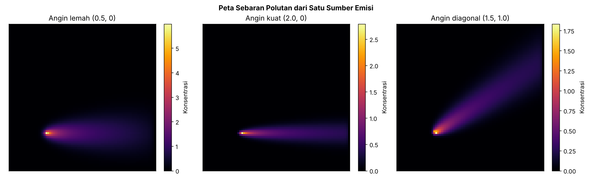
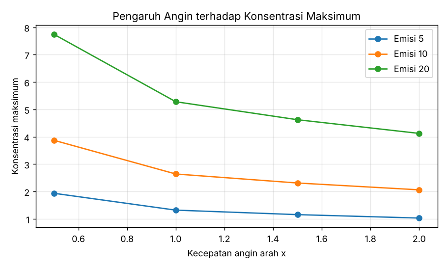
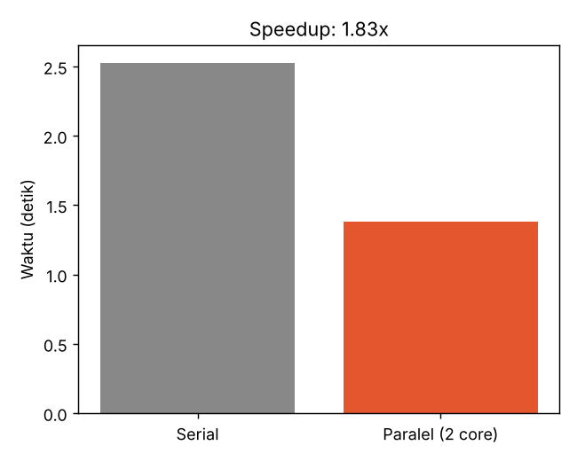

<div align="center">

# 🌫️ Simulasi Sebaran Polusi Udara dengan Komputasi Paralel

### Studi Kasus Pemanfaatan *High Performance Computing* (HPC) untuk Masalah Lingkungan


</div>

---

## 📖 Latar Belakang

Materi pemateri menekankan bahwa HPC bukan sekadar komputer cepat, tetapi **alat untuk menjawab masalah nyata**, seperti prediksi kualitas udara dan cuaca (contoh di Thailand), prediksi banjir, dan pemetaan lahan. Dua prinsip lain dari materi yang menjadi dasar proyek ini:

1. Pekerjaan berat dipecah menjadi banyak tugas yang bisa dijalankan **bersamaan**.
2. Proses harus **terdokumentasi dan dapat diulang (*reproducible*)** agar hasilnya bisa diperiksa kembali.

Proyek ini menerjemahkan kedua prinsip tersebut menjadi simulasi sederhana: **bagaimana asap dari satu sumber (misalnya cerobong pabrik) menyebar di udara**, lalu menjalankan puluhan skenario cuaca sekaligus secara paralel.

## 🎯 Rumusan Masalah

1. Bagaimana pola sebaran polutan dari satu sumber emisi pada kondisi angin yang berbeda?
2. Skenario mana (kecepatan angin, arah angin, laju emisi) yang menghasilkan konsentrasi polutan tertinggi?
3. Seberapa besar percepatan waktu komputasi jika skenario dijalankan paralel dibanding serial?

## 🚧 Batasan Masalah

Agar proyek tetap sederhana, ringan, dan mudah dipahami:

| Aspek | Batasan |
|---|---|
| Dimensi | 2D (tampak atas), grid 80 × 80 sel |
| Sumber emisi | Satu titik tetap di area kiri-bawah |
| Angin | Konstan (tidak berubah terhadap waktu dan lokasi) |
| Proses fisika | Hanya adveksi (terbawa angin), difusi, dan peluruhan |
| Yang tidak dimodelkan | Suhu, hujan, reaksi kimia, bangunan, topografi |
| Data | Data sintetis, **bukan** data pengukuran nyata |
| Tujuan | Edukasi konsep HPC, **bukan** alat prediksi resmi |

> ⚠️ Hasil simulasi ini tidak boleh dipakai untuk keputusan kebijakan atau kesehatan yang sesungguhnya.

## 🧠 Metode

### Model Fisika

Konsentrasi polutan `C` berubah setiap langkah waktu menurut persamaan adveksi-difusi dengan peluruhan:

```
∂C/∂t = D·∇²C − u·∂C/∂x − v·∂C/∂y − λ·C + S
```

| Simbol | Arti |
|---|---|
| `D` | Koefisien difusi (penyebaran alami) |
| `u`, `v` | Kecepatan angin arah x dan y |
| `λ` | Laju peluruhan polutan |
| `S` | Sumber emisi |

Persamaan diselesaikan dengan skema beda hingga: *upwind* untuk suku angin dan beda pusat untuk difusi. Seluruh perhitungan memakai operasi array NumPy (*vectorized*), bukan perulangan per sel.

### Strategi Paralel (Ensemble)

Setiap kombinasi `(angin x, angin y, emisi)` adalah satu simulasi yang **saling independen**. Pola ini disebut *embarrassingly parallel*, sehingga cocok dibagi ke banyak core dengan `multiprocessing.Pool`.

```
          ┌── Core 1 ── skenario 1, 3, 5 ...
36 skenario ─┼── Core 2 ── skenario 2, 4, 6 ...   ──►  gabungkan hasil  ──►  grafik + JSON
          └── Core N ── ...
```

Pada HPC sungguhan, ide yang sama diterapkan lintas node cluster (misalnya lewat penjadwal job seperti SLURM), hanya skalanya jauh lebih besar.

### Skenario yang Diuji

| Parameter | Nilai | Jumlah |
|---|---|---|
| Angin arah x | 0.5, 1.0, 1.5, 2.0 | 4 |
| Angin arah y | -1.0, 0.0, 1.0 | 3 |
| Laju emisi | 5, 10, 20 | 3 |
| **Total skenario** | 4 × 3 × 3 | **36** |

## 📁 Struktur Proyek

```
hpc-polusi-udara/
├── main.py            # Program utama: skenario, serial vs paralel, grafik
├── src/
│   ├── __init__.py
│   └── model.py       # Model sebaran polutan dan ringkasan statistik
├── output/            # Hasil: grafik PNG dan hasil.json
├── requirements.txt   # Pustaka yang dibutuhkan
├── .gitignore
└── README.md
```

## ▶️ Cara Menjalankan

1. Pastikan Python 3.9 atau lebih baru terpasang.
2. Pasang pustaka yang tercantum di `requirements.txt` (NumPy dan Matplotlib).
3. Jalankan berkas `main.py`.
4. Buka folder `output/` untuk melihat grafik dan berkas `hasil.json`.

Tidak ada parameter tambahan yang perlu diatur. Semua nilai skenario sudah ada di dalam `main.py` dan bisa diubah langsung di fungsi `build_scenarios`.

## 📊 Hasil

Hasil di bawah diperoleh dari satu kali eksekusi pada mesin dengan **2 core**.

| Metrik | Nilai |
|---|---|
| Jumlah skenario | 36 |
| Waktu serial | 2,52 detik |
| Waktu paralel (2 core) | 1,38 detik |
| **Speedup** | **1,83×** |
| Hasil serial = paralel | ✅ Identik |
| Konsentrasi maksimum tertinggi | 11,96 (angin x = 0,5, y = 0, emisi = 20) |

### Peta Sebaran



### Pengaruh Kecepatan Angin



### Perbandingan Waktu



## 🔍 Analisis

- **Angin lemah** membuat polutan menumpuk dekat sumber sehingga konsentrasi puncak lebih tinggi, tetapi area terdampak lebih sempit.
- **Angin kuat** menyapu polutan lebih jauh dan membentuk jejak panjang yang tipis, sehingga konsentrasi puncak lebih rendah.
- **Angin diagonal** membelokkan jejak polutan sesuai arah angin, sehingga wilayah terdampak dapat diperkirakan.
- **Laju emisi** berbanding lurus dengan konsentrasi: emisi 20 menghasilkan konsentrasi sekitar dua kali emisi 10.
- **Paralelisasi** mempercepat komputasi mendekati jumlah core (1,83× pada 2 core). Pada mesin dengan lebih banyak core, percepatan akan lebih besar selama jumlah skenario cukup banyak.

## ✅ Kesesuaian dengan Materi Pemateri

| Konsep di materi | Implementasi di proyek |
|---|---|
| Komputasi berkinerja tinggi | Simulasi 36 skenario secara paralel |
| Prediksi kualitas udara | Model sebaran polutan |
| Visualisasi hasil | Tiga grafik otomatis di folder `output/` |
| Proses dapat diulang | Parameter tetap dan hasil serial identik dengan paralel |
| Dokumentasi baik | README ini dan `hasil.json` |
| Kolaborasi lintas bidang | Menggabungkan fisika atmosfer dan ilmu komputer |

## 🚀 Pengembangan Lanjutan

- Menambah sumber emisi lebih dari satu
- Memakai data angin nyata (misalnya dari BMKG)
- Menjalankan di cluster HPC dengan penjadwal job
- Mempercepat dengan GPU
- Memperluas ke model 3D

## 📝 Lisensi

Bebas dipakai untuk pembelajaran. Tambahkan lisensi pilihan Anda (misalnya MIT) sebelum dipublikasikan.
